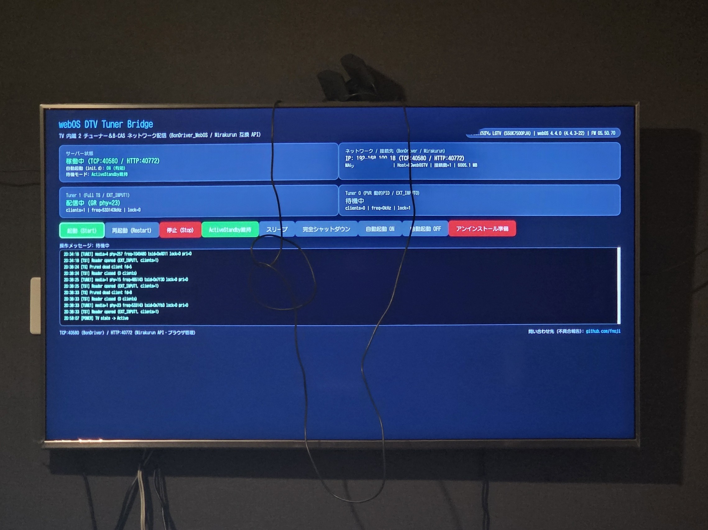
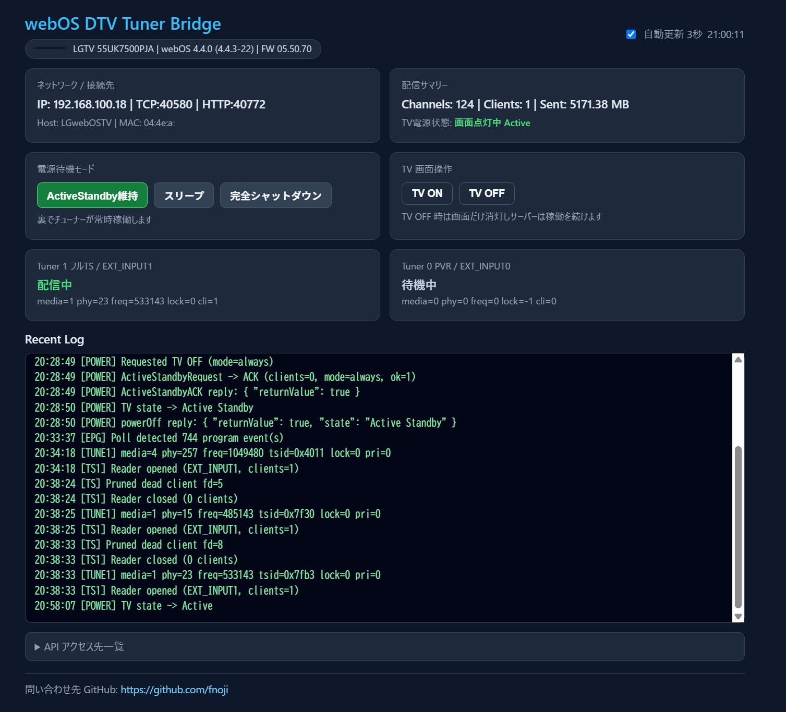

# webOS DTV Tuner Bridge

管理者権限（root）を取得し、Homebrew Channel を導入済みの LG webOS TV に搭載されている **内蔵 2 チューナー** および **内蔵 B-CAS カードリーダー** を、LAN 経由で PC (`BonDriver_WebOS`) や HTTP クライアント (`Mirakurun` 互換 API `:40772`) から利用できるようにするブリッジツールです。

これをインストールしたLGTVでは、Mirakurun互換APIをLAN上で利用できるようになりますので、TVTestやEPGStation連携にて、ts抜きが可能です。
TVTestで利用する場合はBonDriver_Mirakurun.dllではなく、同梱しているBonDriver_WebOS.dllが必要です。

TV 本体のシステムパーティション（リードオンリー領域）や純正アプリバイナリは一切改変しておらず、`/media/developer` 配下を中心に動作します（LS2 ロール登録のため `/var/luna-service2` 配下と、自動起動用に `/var/lib/webosbrew/init.d` へ設定ファイルを追加します。これらはアプリ内の「アンインストール準備」で削除されます。`tvservice` への `.so` 注入はメモリ上のみで、TV を再起動すると消えます）。

基本的には自分用に作成しています。
動作確認機は日本版LGTVになるLG 55UK7500PJA (webOS 4.x / Rockhopper 4.4.3-22)のみとなります。
webOS 5.x 以降での動作確認はしておらず、BS4K は現状非対応です。


---


## インストール後の使用方法

**1. webOS 上にインストールしたアプリ**



**2. LAN 上でアクセスできる内容**



双方とも情報を読み取るツールですが、LAN 側の Web UI では TV の遠隔操作（電源・選局状態の確認など）が可能で、TV アプリ側では起動・自動起動・アンインストール準備を重視しています。

## 主な機能

- **2 チューナー同時配信**
  - **Tuner 1 (`EXT_INPUT1`)**: フル TS 配信パイプ（優先割り当て）。通常 TV 画面とは独立した裏チューナーとして稼働します。
  - **Tuner 0 (`EXT_INPUT0`)**: PVR エンジン＋動的 PID 抽出 (`PAT` / `CAT` / `PMT` 解析) パイプ。2 番組同時視聴・録画時に使用されます。
  - 既定 (`Tuner=auto`) では空きチューナーを自動割り当てします（`BonDriver_WebOS.ini` で `1` / `0` 固定も可能）。
- **TV 内蔵 B-CAS による複号配信**
  - TV 上で Multi2 デスクランブルした MPEG2-TS を配信するため、PC 側に別途 IC カードリーダーを接続せずに視聴・録画できます（`DecodeOnTV=1`）。
- **3 つの電源待機モード切替 & Wake-on-LAN (WOL) 復帰**
  - **ActiveStandby維持 (`always` / 既定)**: TV リモコンや WebUI 等で電源を OFF にした場合も、画面・音声だけを消灯した **`Active Standby` 状態を維持** し、チューナーサーバーとしていつでも即座に接続できる状態で待機します。
  - **スリープ (`ondemand`)**: 配信中の電源 OFF 時のみ `Active Standby` で配信を続け、全クライアント切断から 5 秒後に通常の Quick Start スタンバイへ移行します（サーバー停止、WOL により約 2 秒で即座に復帰可能）。
  - **完全シャットダウン (`shutdown`)**: TV OFF 時に OS を完全停止（Cold Off）します。WOL で復帰できるかは機種・ファームに依存するため、復帰できない場合はリモコンまたは本体の電源ボタンで起動してください（WOL で復帰する場合は起動に約 20 秒かかります）。
  - モード切り替えは TV 内アプリ (`webOS DTV Tuner`) のボタンまたはブラウザ (`http://<TVのIP>:40772/`) からいつでも変更できます。
- **TVTest経由のBonDriver_WebOS実行時以外の Wake-on-LAN 復帰手段（付属ツール）**
  - `BonDriver_WebOS` による TVTest 起動時の自動 WOL に加え、PC からワンクリックで TV を復帰させる各種ツールを同梱しています（開発環境固有の MAC や IP の直書きは一切なく、同フォルダの `BonDriver_WebOS.ini` から自動取得されます）。
    - **`wake_tv.bat`**: Windows 標準機能（PowerShell）のみで Magic Packet を送信する軽量バッチ。ダブルクリックで約 2 秒で TV が復帰します。
    - **`wake_tv.exe`**: Win32 ネイティブ CLI ツール（約 160KB〜210KB、C ランタイム静的リンク / 外部依存なし）。EPGStation の `recordingPreStartCommand`（録画準備開始フック）やタスクスケジューラとの連携に最適です。MAC アドレスは引数か `BonDriver_WebOS.ini` から取得し、どちらにも無い場合はエラー終了します（ハードコードの既定値は持たないため、初回は `wake_tv.exe <MAC> -w` のように指定してください）。
- **Mirakurun 互換 HTTP API (ポート `40772`) & Web 管理画面**
  - EPGStation 等と連携できる Mirakurun 互換 REST API・イベントストリーム (`/api/events/stream`)・サービス単位 PID 絞り込み TS 配信・`X-Mirakurun-Priority` 優先度奪取に対応しています。
  - TV 内アプリ (`webOS DTV Tuner`) および PC ブラウザ (`http://<TVのIP>:40772/`) から TV モデル/webOS バージョン・TV ネーム・IP アドレス・各チューナー稼働状態・ログを確認でき、ブラウザからは 3 秒ごとの自動更新・電源待機モード選択・TV 画面 ON/OFF 操作も行えます。
- **セキュリティ堅牢化**
  - **DNS リバインディング対策**: HTTP リクエストの `Host` ヘッダを厳格に検証し、IP リテラル・自機ホスト名・`localhost` 以外の外部ドメイン経由のアクセスを `403 Forbidden` で即座に遮断します。
  - **CSRF 対策**: TV の電源や待機モードを変更する `/api/power` は `POST` メソッドを必須化し、他サイトからの画像タグ (``) 等を用いた意図しない電源操作を防ぎます。ただし TV 内アプリ / `tunerctl.sh` が使用する同一端末内 (`127.0.0.1`) からの操作は GET でも許可します。不要なワイルドカード CORS ヘッダ (`Access-Control-Allow-Origin: *`) も排除しています。

---

## 配布ファイル構成 (`release/`)

```text
release/
├─ README.md
├─ tv-ipk/
│  └─ webos_dtv_tunerbridge.ipk               # TV 側 Homebrew アプリ (.ipk)
└─ pc-bondriver/
   ├─ wake_tv.bat                              # ダブルクリックで TV を復帰するバッチ
   ├─ wake_tv.exe                              # 軽量 WOL コマンド (EPGStation 等の連携用)
   ├─ x64/                                     # 64bit アプリ向け (TVTest 64bit 等)
   │  ├─ BonDriver_WebOS.dll
   │  ├─ BonDriver_WebOS.ini
   │  └─ wake_tv.exe
   └─ x86/                                     # 32bit アプリ向け (TVTest 32bit 等)
      ├─ BonDriver_WebOS.dll
      ├─ BonDriver_WebOS.ini
      └─ wake_tv.exe
```

---

## 導入手順

### 1. TV 側の準備 (管理者権限取得済み LG webOS TV)

1. TV の設定で「クイックスタート+ (Quick Start+)」を ON にし、LAN 経由電源オン（Wake-on-LAN）が機能する状態にしておきます。
2. `tv-ipk/webos_dtv_tunerbridge.ipk` を Homebrew Channel のインストーラや `ares-install` 等で TV にインストールします。
3. TV のホーム画面から **「webOS DTV Tuner」** を起動します。
4. 「起動 (Start)」を押してサーバー状態が「稼働中」になることを確認し、常時使う場合は「自動起動 ON」を押します。
   - 画面上部に表示される **IP アドレス**（および `TCP:40580` / `HTTP:40772`）をメモしておくと PC 側設定がスムーズです。

> **アンインストール時の注意**: アプリを削除する前に、TVアプリ画面の「アンインストール準備」（誤操作防止のため 5 秒以内に 2 回押し）を実行し、常駐デーモンと自動起動フック・LS2 登録設定（`/var/luna-service2` 配下等）を解除してからアプリを削除してください。

### 2. PC 側の準備 (`BonDriver_WebOS`)

1. 使用するソフト（TVTest 等）に合わせて `pc-bondriver/x64/` または `pc-bondriver/x86/` 内の `BonDriver_WebOS.dll` と `BonDriver_WebOS.ini` をソフトのフォルダへコピーします。
2. 既定では `Host=auto`（UDP ブロードキャスト自動検出）、`Tuner=auto`（空きチューナー自動割り当て）で動作します。固定 IP や特定チューナーに固定したい場合は `BonDriver_WebOS.ini` を編集してください。
3. **2 チューナー同時利用する場合**:
   - `BonDriver_WebOS.dll` を別名（例: `BonDriver_WebOS_T2.dll`）にコピーして同じフォルダへ配置してください。
   - 専用 `.ini`（`BonDriver_WebOS_T2.ini`）が無い場合でも、同フォルダの `BonDriver_WebOS.ini` を自動で参照します。

### 3. PC 側での WOL ツール活用（TVTest 以外の起動）

- **TV をあらかじめ起こしておきたいとき**:
  - `wake_tv.bat` をダブルクリック（またはデスクトップにショートカットを作成）すると、`BonDriver_WebOS.ini` の MAC アドレス（Wi-Fi / 有線 LAN）宛てに Magic Packet が送られます。
- **EPGStation で録画前に TV を自動復帰させたいとき**:
  - EPGStation の `config.yml` にある `recordingPreStartCommand`（録画準備開始フック）に `wake_tv.exe` のフルパスを指定します。
  ```yaml
  recordingPreStartCommand: 'C:\TVTest\wake_tv.exe -w'
  ```
  `-w` を付けると Magic Packet 送信後に TV の起動（`:40772` の疎通）を最大 15 秒待つため、スリープからの復帰が確実になります。完全シャットダウンからの復帰は時間がかかるため、そのモードでは録画開始に余裕を持たせてください。

---

## ビルド方法 (開発者向け)

### PC 側 (`BonDriver_WebOS.dll` & `wake_tv.exe`)
- ソース: `pc-bondriver/BonDriver_WebOS.cpp`, `pc-bondriver/wake_tv.cpp`
- Visual Studio 2022 (C++ ビルドツール) がインストールされた環境で、PowerShell から以下を実行します：
  ```powershell
  cd pc-bondriver
  .\build.ps1 -Arch x64
  .\build.ps1 -Arch x86
  ```
  `build/x64/` および `build/x86/` に `BonDriver_WebOS.dll`, `wake_tv.exe`, `test_bondriver.exe` が生成されます。

### TV 側 (`webos_tuner_d` & `.ipk`)
- ソース: `tv-bridge/webos_tuner_d.c`, `webos-ipk/`
- 前提: `tv_libs/` に TV 本体の glibc（`libc.so.6`, `libpthread.so.0`, `libdl.so.2`, `ld-linux.so.3`）を配置します。LG ファームウェア由来のため**リポジトリには含まれません**（取得方法は `tv_libs/README.md` 参照）
- Linux / WSL 環境にて `arm-linux-gnueabi-gcc` を使用してビルドします：
  ```bash
  cd tv-bridge && make
  cd ../webos-ipk && ./build_ipk.sh
  ```
  `webos-ipk/webos_dtv_tunerbridge.ipk` が生成されます。

---

## 仕様上の注意点・制限事項

- **Tuner 0 (PVR) と TV 本体視聴の共有・保護ポリシー**:
  - `Tuner 0` は TV のメイン系フロントエンド (`EXT_INPUT0`) を共有するため、`Tuner 0` で視聴・選局すると TV 本体の選局先と連動します（PC 側で別チャンネルへ切り替えると TV 側の受信映像・エラー表示に影響します）。
  - TV 画面が点灯中 (`Active`) かつ `Tuner 1` が使用中の場合、`X-Mirakurun-Priority < 2`（通常の PC 視聴等）の自動割り当ては `Tuner 0` を使わず `503` を返して TV 視聴を保護します。`X-Mirakurun-Priority >= 2` の録画要求・`Active Standby` 消灯中・明示的な `Tuner=0` 指定時は `Tuner 0` を使用します。
- **電源待機モードと TV OFF 時の挙動**:
  - `ActiveStandby維持`: TV OFF 時は画面と音声のみ消灯し、チューナーサーバーは完全稼働を維持します（待ち時間 0 秒で即時配信可能）。
  - `スリープ`: TV OFF するとチューナーサーバーも停止します（`BonDriver_WebOS` や `wake_tv.bat` 等の WOL で約 2 秒で即座に復帰可能）。
  - `完全シャットダウン`: TV OFF 時に OS を完全停止（Cold Off）します。WOL 復帰の可否は機種・ファームに依存し、復帰する場合も起動に約 20 秒かかります。
- **Mirakurun 互換 API (`:40772`) および EPGStation 連携について**:
  - 本サーバーは Node.js 版の本家 Mirakurun ではなく、C 言語で実装された軽量互換サーバーです。本家 Mirakurun 側のアップデート管理とは独立しています。
  - 対応エンドポイント: `/api/version`, `/api/status`, `/api/config/server`, `/api/events/stream`, `/api/power`, `/api/tuners`, `/api/tuners/:index`, `/api/channels`, `/api/services`, `/api/services/:id`, `/api/services/:id/programs`, `/api/services/:id/stream`, `/api/programs`, `/api/programs/:id`, `/api/programs/:id/stream`。
  - **サービス絞り込み配信**: `/api/services/:id/stream` および `/api/programs/:id/stream` は指定サービスの映像・音声・字幕・データ放送カルーセル (`0x0B`/`0x0C`/`0x0D`)・PCR・ECM・PMT と共通 PSI/SI のみへ PID を絞り込み、PAT を単一サービス構成へ書き換えて送信します（`/api/channels/:type/:ch/stream` および `BonDriver_WebOS` はフル TS 配信）。
  - **`X-Mirakurun-Priority` 優先度制御 & 送信タイムアウト耐性**: 両チューナー使用中であっても、`X-Mirakurun-Priority`（`-128..128`、既定 `0`）が既存クライアントより大きい場合（または `>= 128`）は低優先度クライアントを切断して録画等へチューナーを明け渡します。配信ソケットは `SO_SNDTIMEO=12秒` かつ連続 3 回タイムアウトまで許容し、タイムアウト時は 1 秒スキップして他クライアントへの巻き添えを防止します。
  - **番組表・変更通知**: 番組表データ (`/api/programs`) は放送波 TS の `EIT` (`PID 0x12〜0x26`) を自前で直接解析して構築し、アイドル時の自動巡回スキャン（GR → BS → CS、クライアント選局時は即中断・45 秒クールダウン）および視聴中/外部スキャン中の受動収集で更新します。新規 (`create`)・変更 (`update`)・削除 (`remove`) 差分は `/api/events/stream`（連結 JSON 形式）へ逐次配信します。
  - **チャンネル一覧は「TV 純正機能の受信結果」に依存し、番組表 (EPG) は放送波 EIT を優先します**:
    - チャンネル一覧 (`/api/services`・`/api/channels`) は TV 純正の LS2 DB (`com.palm.db` の `com.webos.service.tv.channel.dblist:1`) から読み出すため、TV 本体側でのチャンネルスキャンが必要です（未スキャン局や BS4K 等の非対応波は現れません）。
    - 番組表 (`/api/programs`) は起動直後や未受信局の暫定フォールバックとしてのみ TV 純正 EPG DB (`com.webos.epgdb` の `com.webos.service.tv.programSCH:4`) を併用し、放送波 `EIT` を受信できた局・番組はすべて放送波由来データで上書き・優先します。そのため TV 本体側で未選局の CS 局等も自動で番組表が揃い、サブチャンネルの共有イベント (`relatedItems` 等) も Mirakurun 準拠で制御されます。
    - `com.palm.db` / `com.webos.epgdb` の LS2 サービス名・DB スキーマは webOS のバージョンや機種で変更される場合があります。動作検証は webOS 4.4.3（55UK7500PJA）のみのため、他環境で一覧や番組表が取得できない場合は `/api/log` と `/api/status` を確認してください。
  - **未対応**: 放送局ロゴ画像 (`/api/services/:id/logo`)。
- **対応機種の範囲**:
  - LG 55UK7500PJA (webOS 4.x / Rockhopper 4.4.3-22) 実機にて動作検証しています。webOS バージョンや SoC 世代によっては内部 HAL シンボルの差異により動作しない場合があります。

---

## 問い合わせ先

不具合報告や要望は GitHub までお寄せください。

- GitHub: https://github.com/fnoji
